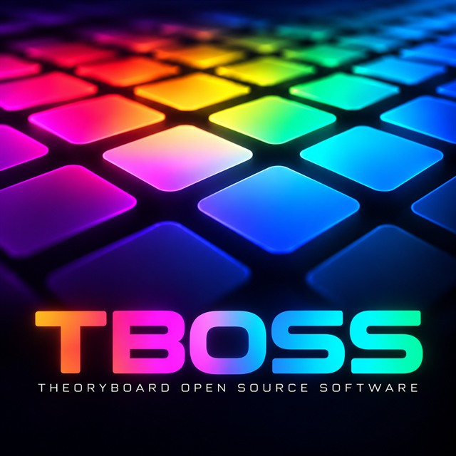

  

# TBOSS — TheoryBoard Open Source Software

**Open-source firmware for the TheoryBoard THY333** music controller: play chords and
melodies by scale degree, with strum, hold, an arpeggiator, chord names on the display,
presets, custom scales from a web editor, and full MIDI control.

> **Alpha.** TBOSS is an independent community project, not affiliated with, endorsed or
> supported by the makers of the TheoryBoard. It installs from the browser through the
> board's own update mode and never touches the board's start-up loader, so you can
> always reinstall, or go back to the original firmware with the manufacturer's update
> utility ([how](docs/flashing.md#going-back-to-the-original-firmware); the original files are
> [archived here](https://github.com/armandhammer/TheoryBoard-Original-Firmware)). Use it at your own risk, and please tell us what works and what doesn't.

**Install:** https://armandhammer.github.io/TBOSS/install.html (Chrome or Edge) ·
**Editor:** https://armandhammer.github.io/TBOSS/ · **Current version: 0.6.2**

## Getting started

You need the TheoryBoard, its USB cable, and Chrome or Edge on a computer (Windows,
macOS, Linux or ChromeOS). Nothing else to install.

1. Open the [installer](https://armandhammer.github.io/TBOSS/install.html). It offers the
   current version.
2. **Updating from an earlier TBOSS?** Click *Save settings* on the page first (step 2):
   your settings, presets and scales come back after installing.
3. Start the board in **update mode**: unplug the USB cable, hold the **top-left and
   bottom-left pads of the left half**, plug the cable back in and keep holding about
   3 seconds. The screen shows the TheoryBoard logo.
4. Click *Connect*, choose **TheoryBoard**, then *Install TBOSS*. It takes about a minute;
   the board restarts by itself. (Linux needs a one-time permission rule:
   [installation guide](docs/flashing.md).)
5. Play: the computer sees a MIDI device **TheoryBoard MIDI**. Press the centre button
   below the screen for the settings; the [manual](docs/manual.md) explains everything.
6. Custom scales and backups: the [web editor](https://armandhammer.github.io/TBOSS/).

To go back to the original firmware, see
[Going back](docs/flashing.md#going-back-to-the-original-firmware).

## Status

Version 0.6.2, **alpha**, tested on one board so far. 0.6 added the original
TheoryBoard's chord panel (with its button lights), drum mode, 12 user scales and much
more (below). Some features of the original firmware are not in TBOSS yet (sequencer…): see
[Known issues](docs/manual.md#known-issues) and the [roadmap](docs/roadmap.md).

**Testers wanted:** install it, go through the manual's
[feature check](docs/manual.md#feature-check) and file a
[test report](../../issues/new?template=test_report.yml), even if everything worked.
Especially wanted: anyone with a **TRS Type A MIDI adapter** or a **sustain pedal**. Both
jacks are not yet confirmed on a board; Settings → About → *I/O test*
shows what the board sees.

## Features

- **96 pressure-sensitive pads:** chords by scale degree on the left (four voicings
  per chord), melody on the right; velocity from strike force.
- **Any key and scale:** 12 root buttons; major, minor, the seven modes, harmonic and
  melodic minor, pentatonics, chromatic, blues, whole tone, diminished, Hungarian minor,
  Hirajoshi and more (25 built in); plus **12 custom scales** made on a piano keyboard in
  the web editor. *(0.6.0)*
- **Chord panel:** the centre buttons do what the board prints: inversions, guitar
  voicing, spread (root down 1–3 octaves) and octave shift or stacking for every chord. *(0.6.0)*
- **Chord edits:** add 6th/7th/9th, sus2/sus4, strum on/off, per pad.
- **Melody layouts:** scale, chromatic, fourths, and **drum mode** (scale, bass and
  General MIDI drum grids on their own channels). *(0.6.0)*
- **Chord names on the display:** `Dm7`, `G7sus4`, `Am/C` ...
- **Hold, strum** (up, down, alternating; in ms or note values; repeat while held,
  cutoff) and an **arpeggiator** (up, down, up-down, random, as played, chords; 1-3
  octaves; rhythm patterns, swing, latch; synced to your DAW's MIDI clock).
- **MIDI clock out** and Start/Stop; pedal as sustain, sostenuto, soft, portamento,
  hold, play/stop or a drum note. *(0.6.0)*
- **MIDI:** separate channels for chords and melody; pressure set per half as poly
  aftertouch (chord pads too), channel aftertouch, mod wheel, breath, expression,
  filter (CC74) or pitch bend; velocity curves.
- **Rainbow pad lights** that follow your key and scale, white under your fingers
  (brighter as you press harder), and show incoming MIDI notes.
- **8 presets** and saved settings.
- **TRS MIDI out** (Type A) to hardware synths, also without a computer, and a
  **sustain pedal** input (sustain or hold). Not yet confirmed on a board.
- **Settings menu** on the display, driven by the five buttons below it (back, up,
  enter, down, deeper).
- **Web editor** (Chrome/Edge): custom scales, settings backup and restore, and a
  verified backup of the board's 16 MB memory chip.
- **Browser installer:** a USB cable and Chrome or Edge; keeps your settings across updates.
- USB MIDI class compliant: no drivers on Windows, macOS or Linux.

## Documentation

| | |
| --- | --- |
| [User manual](docs/manual.md) | Every feature, step by step, and a feature check |
| [Installing](docs/flashing.md) | From the browser; going back; advanced: SWD adapter |
| [Hardware reference](docs/hardware.md) | MCU, memory map, loader, pads, touch controllers, LEDs, display, memory chip, J2 |
| [Building and testing](docs/building.md) | Reproducible build, native tests |
| [Firmware architecture](docs/architecture.md) | How the code is organised, how to add a feature |
| [SysEx protocol](docs/tb-sysex.md) | What the web editor sends |
| [Update mode protocol](docs/installer-protocol.md) | What the browser installer sends |
| [Roadmap](docs/roadmap.md) | Customisable buttons, more ideas |

## Issues

Use [Issues](../../issues) for bug reports, feature ideas and hardware findings (there
are templates for each). Please include the TBOSS version (Settings → About on the board)
and what you were doing. Questions, ideas and experiences: [Discussions](../../discussions).
Releases with the firmware file (`theoryboard-usb.bin`) are [here](../../releases).

## Contributing

Pull requests are welcome; see [CONTRIBUTING.md](CONTRIBUTING.md) and the
[code of conduct](CODE_OF_CONDUCT.md). The build must pass its safety check and the tests;
GitHub runs both on every pull request.

## License

TBOSS is free software under the **GNU General Public License v3.0 or later**
([LICENSE](LICENSE)). The build downloads and uses TinyUSB (MIT) and the CMSIS
headers from Arm and ST (Apache-2.0) at pinned versions; they are not part of this
repository. "TheoryBoard" is a trademark of its holder and is used here only to say which
device this firmware runs on.
